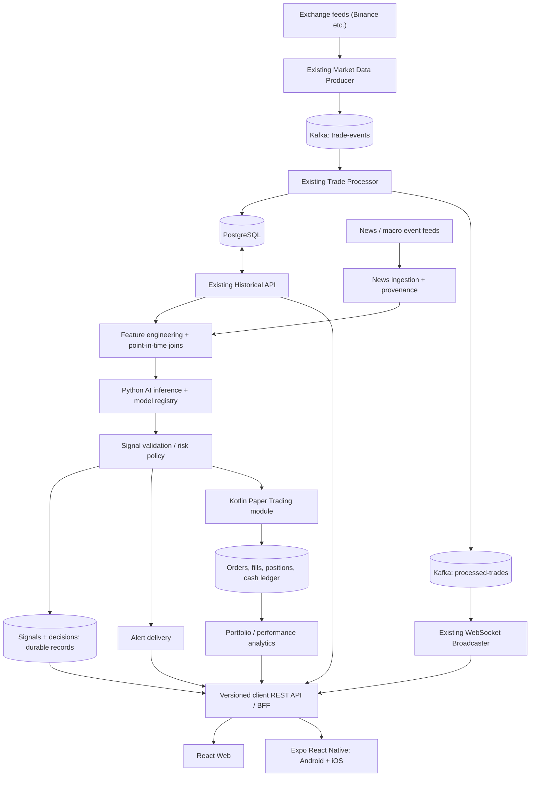
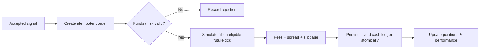

# AI Crypto Intelligence & Paper Trading — target architecture

**Status:** Proposed design, not implemented functionality. Baseline: main at `2ed638c3` (2026-10-27). No real-money order execution is planned for v1. Existing application reportedly runs locally; full-stack behavior and performance need verification.

## Goals and non-goals
- Analyze live and historical crypto OHLCV, technical indicators, timestamped news and economic/event context.
- Produce versioned, explainable direction/probability estimates for clearly defined horizons.
- Deliver alerts and run **spot-only, long-only simulated trading** with measured fees, spreads, slippage and recorded assumptions.
- Measure model predictive skill and simulated strategy performance separately; compare with simple baselines.
- Serve React Web, Android and iOS through shared versioned API contracts.
- **Out of scope v1:** broker keys, real-money trades, leverage, guaranteed profit predictions, Kubernetes, multiple unnecessary microservices.

## Logical component architecture

**Diagram is conceptual:** the client REST/BFF, news ingestion, prediction, risk, paper trading, and shared mobile API are proposed. WS may connect directly to clients through a controlled endpoint; the diagram simplifies auth and fanout. Preserve Kafka-to-database consistency by explicit acknowledgment, retry/idempotency and transactional outbox where justified; no exactly-once cross-system claim.

## Service boundaries and implementation order
| Component | Proposed owner | Phase | Important contract |
|---|---|---|---|
| Market ingestion, trade processing, historical REST, WS | Existing Kotlin/Spring services | Harden first | Stable IDs, UTC timestamps, reproducible event delivery |
| News ingestion + sentiment | Python module/job; not separate always-on container initially | AI stage | Event time **and** first-observed time; source, asset, confidence, dedup |
| Technical features | Python jobs shared with model training | AI stage | Point-in-time joins and dataset versioning |
| Prediction | Python / FastAPI process (optional at dev time) | AI stage | Model version, horizon, calibrated probability, input cutoff |
| Risk decisions | Pure domain module | AI stage | Reasons for reject/accept, exposure/volatility limits |
| Paper trading | Kotlin module/process | Paper stage | Decimal arithmetic, immutable fills/ledger, deterministic replay |
| Portfolio analytics | Module + read APIs | Paper stage | Equity, realized/unrealized P&L, fees, max drawdown |
| Client API | Versioned REST plus WS/SSE contract | Web/mobile stage | DTO/OpenAPI schemas, pagination, auth boundary |
| React / React Native | Separate UI packages | Ongoing | Shared domain schemas, independent UX |

## Critical data flows
### Live market data
1. Exchange tick → normalize/idempotent event → Kafka (symbol partition key).
2. Processor persists then publishes via a documented durable strategy; Redis cache is an optimization.
3. Broadcaster emits only validated events to subscribed clients; clients detect gaps, stale feeds and reconnect.

### AI signal
1. Persist historical candles and news **as observed at that time**, including data availability delays.
2. Build features for symbol, prediction timestamp and explicit horizon (start with BTCUSDT / ETHUSDT, 4h).
3. Train baseline (logistic regression) then evaluate tree model against a held-out walk-forward period; calibrate probabilities.
4. Write `signal_id, symbol, created_at, horizon, model_version, probability, feature_cutoff_at, evidence`.
5. Apply deterministic risk/alert thresholds; do not present LLM text as a calibrated probability.

### Paper-trading lifecycle

Paper trading must not consume future market data at signal time. In replay, use deterministic clock/config with no implicit hindsight. Keep order/fill IDs and currency precision stable.

## Proposed core entities
- `news_events(id, source, published_at, observed_at, assets, sentiment, event_type, provenance)`
- `feature_sets(symbol, as_of, feature_version, cutoff_at, artifact_uri)`
- `model_versions(id, trained_through, data_version, metrics, artifact_uri)`
- `signals(id, symbol, created_at, horizon, probability, direction, model_version, status, rationale)`
- `signal_outcomes(signal_id, evaluated_at, realized_return, labels)`
- `paper_accounts(id, base_currency, created_at)`
- `paper_orders(id, account_id, signal_id, symbol, side, quantity, status)`
- `paper_fills(id, order_id, executed_at, price, quantity, fee)`
- `cash_ledger(id, account_id, currency, amount_delta, cause_id, created_at)`
- `positions(account_id, symbol, quantity, cost_basis)`
- `portfolio_snapshots(account_id, as_of, equity, drawdown)`

These are **logical entities**, not migrations or current tables. Decide ownership and unique constraints before coding.

## Modeling safeguards and portfolio evidence
- Respect publication/observed timestamps; no news/data leakage, no look-ahead fills.
- Time-ordered walk-forward split with untouched evaluation period; no tuning on test data.
- Measure calibration, precision/recall, coverage and error by market regime; then separately evaluate equity curves, costs, max drawdown, Sharpe and comparison to buy-and-hold/no-trade.
- Log model and input dataset versions with each signal; explain factors without fabricating causation.
- Display uncertainty, expired signals and educational/demo disclaimer.

## Decisions
- **No React rewrite by default**: React 19, Vite, TanStack Query and Zustand already provide a modern base. Audit component UX and state duplication; incrementally redesign dashboard.
- **No new AI microservice swarm**: offline jobs + optional inference process first.
- **No shared client implementation**: separate React web and Expo RN views, common API schemas and optionally pure TypeScript domain utilities only.
- **No real-money execution**: paper fills are simulated and cannot be mistaken for exchange orders.

See [MILESTONES-AI.md](MILESTONES-AI.md), [PROJECT-STRUCTURE-AND-TECH.md](PROJECT-STRUCTURE-AND-TECH.md), [MOBILE-ROADMAP.md](MOBILE-ROADMAP.md) and [RESOURCE-OPTIMIZATION.md](RESOURCE-OPTIMIZATION.md).
