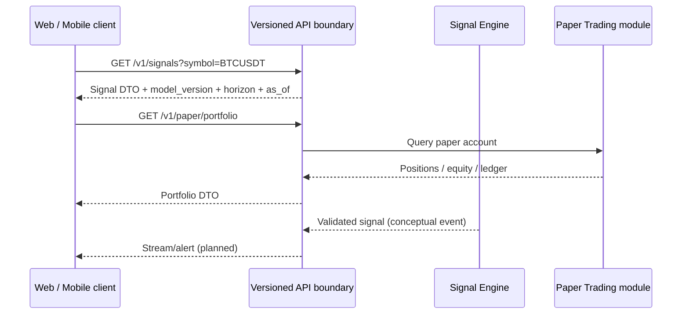

# Target project structure, technology and delivery flow

Current paths observed: `market-data/`, `trade-processor/`, `websocket-broadcaster/`, `historical-service/`, `common-models/`, `client-connection/`, and root `docker-compose.yml`. **Keep paths during incremental evolution; below is a target layout, not a mass-move instruction.**

```text
trading-app/
├── market-data/                 # Spring/Kotlin ingestion
├── trade-processor/             # Kafka processing & persistence
├── websocket-broadcaster/      # live delivery
├── historical-service/         # candles/trades API
├── common-models/              # event DTOs
├── client-connection/          # React web; refactor feature-by-feature
│   └── src/features/           # planned signals, watchlist, alerts, paper, analytics
├── ai-engine/                  # planned Python package
│   ├── ingestion/              # news provider clients and data provenance
│   ├── features/               # feature builders and point-in-time validation
│   ├── training/               # offline jobs + walk-forward evaluation
│   ├── inference/              # optional FastAPI inference
│   └── tests/
├── paper-trading/              # planned Kotlin module (may start in market-data component)
│   ├── domain/                 # risk policies, orders, fills, ledger
│   ├── application/            # commands, event handlers
│   └── persistence/
├── contracts/                  # planned versioned OpenAPI/event schemas
├── docs/                       # ADR, diagrams, flows, benchmarks, milestones
└── docker-compose.yml          # infra-only default; optional full-stack profile target
```

## Technology decisions
| Concern | Preferred choice | Why |
|---|---|---|
| backend | Kotlin, Spring Boot/WebFlux, Kafka | Reuse investment and showcase distributed processing |
| Durable store/cache | PostgreSQL, Redis | Source of truth + bounded cache |
| Browser | React 19, TypeScript, Vite, TanStack Query, Zustand | modern stack; avoid total rebuild |
| Mobile | Kotlin/Jetpack Compose for Android; Swift/SwiftUI for iOS | Cross-platform with reusable TypeScript contracts |
| AI / NLP | Python, pandas/numpy, scikit-learn, optional LightGBM/XGBoost, FastAPI | Model training, evaluation and inference |
| News | Approved provider adapters, time-stamped event registry, optional LLM sentiment | Traceability and leakage control |
| API contracts | OpenAPI for REST, schema-versioned Kafka events | Web/mobile interoperability |
| Test | JUnit/Testcontainers, pytest, Vitest + RTL, Playwright, Compose UI tests and XCUITest | Deterministic domain and integration tests |
| DevOps | Docker Compose + GitHub Actions; profiling before tuning | Local repeatability without mandatory Kubernetes |
| Observability | Spring Actuator/Micrometer, Prometheus/Grafana optionally | Evidence of performance and resilience |

Versions and dependency compatibility must be validated when implementation begins; no new packages were installed by this docs-only PR.

## API-first client flow


The sequence is a **target contract**, not proof of endpoints. Mock and real adapters must implement the same response types. Define idempotency key for paper orders and auth before exposing mutations.

## Frontend modernization sequence
1. Audit current screens/features and choose navigation structure. Preserve live chart/feed integration.
2. Consolidate duplicate stores/API hooks; introduce `features/market`, `features/signals`, `features/paper`, `features/analytics`.
3. Create a shared typed API abstraction and mock backend adapter.
4. Redesign watchlist, signal detail/explanation, paper portfolio, performance and alert UX incrementally.
5. Add accessibility, responsive layouts, loading/reconnect states and E2E tests.
6. Only consider a full rewrite after measured maintainability or UX blockers justify it.

## Development resource plan
- Daily: `docker compose up -d kafka postgres redis` + JVM/React host development (check broker listeners).
- AI: training offline; start FastAPI inference only when needed.
- Mobile: Expo dev tooling and emulator/device separately, not in Docker.
- Demo: optional Compose profiles, measured JVM memory, Kafka UI opt-in and publish container benchmarks.
- See [resource optimization](RESOURCE-OPTIMIZATION.md) for baseline and profiling TODO.

## Independent mobile repositories
The Android and iOS clients live in separate repositories. See [Android](ANDROID-STANDALONE-APP.md) and [iOS](IOS-STANDALONE-APP.md). Both use the same API contract but their own native UI layers.
