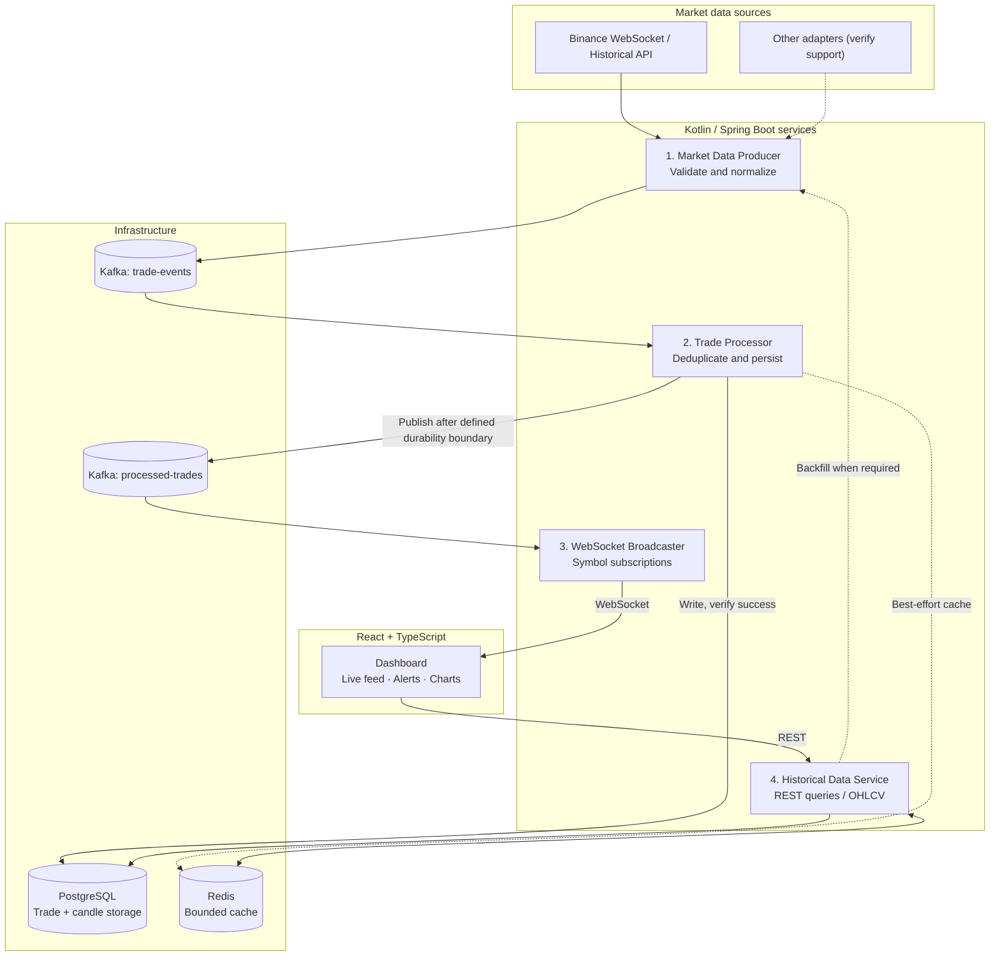

# Target architecture — v1.0

> **Proposed architecture, not a claim of production readiness.** The four Kotlin services and React client exist, but full-stack Compose deployment, reliability guarantees and performance need verification. See [milestones](MILESTONES.md) and [architecture decisions](ARCHITECTURE-DECISIONS.md).

## Real-time and historical data paths



Dashed lines denote optional/best-effort paths or dependencies requiring verification. **The arrows express target data flow, not a currently verified transaction boundary.** In particular, database persist + publish is not an atomic operation in the inspected TradeConsumer; see ADR-002 for alternatives such as transactional outbox.

## Separation of responsibilities
| Component | Contract | Failure / correctness requirement |
|---|---|---|
| Market Data Producer | Normalized market events into Kafka | Reconnect, avoid event explosions, consistent symbol and timestamp |
| Trade Processor | Validated trades into Postgres, processed event out | Idempotency, retry, acknowledgments, durable publish boundary |
| WebSocket Broadcaster | Live updates to subscribed browsers | Reconnect, bounded buffers, fanout and stale-data indication |
| Historical Service | REST candles/trades by symbol and time range | Consistent OHLCV, gap/backfill rules, cache correctness |
| React UI | Live dashboard + history | Mode clarity, offline UX, typed payloads and deduplication |

## Recommended repository layout (target)
```text
trading-app/
├── market-data/
├── trade-processor/
├── websocket-broadcaster/
├── historical-service/
├── common-models/
├── client-connection/
├── docs/
│   ├── README.md
│   ├── TARGET-ARCHITECTURE.md
│   ├── MILESTONES.md
│   ├── ROADMAP.md
│   ├── RESOURCE-OPTIMIZATION.md
│   └── ARCHITECTURE-DECISIONS.md
└── docker-compose.yml
```

## Development vs portfolio demo
- **Lightweight dev:** Kafka, PostgreSQL and Redis in Docker; JVM/React run on host after verifying Kafka advertised listeners.
- **Full-stack demo (target):** all four services start consistently and health checks validate readiness. Current Compose comments out three of those services.
- **Portfolio evidence:** tested reliability scenarios, CI, actual before/after RAM and CPU figures, measured p95 latency, diagram and short demo video.

## Related
- [Six milestones with acceptance criteria](MILESTONES.md)
- [Prioritized TODO](ROADMAP.md)
- [Docker resource optimization](RESOURCE-OPTIMIZATION.md)
- [Original architecture reference](Architecture.md)
